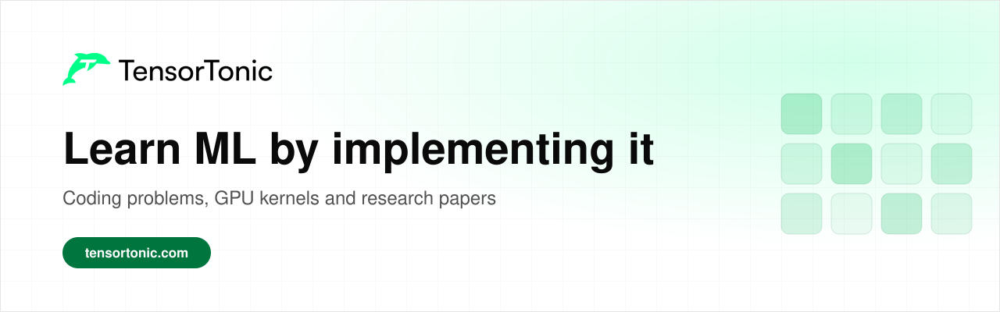

[TensorTonic](https://www.tensortonic.com) is a practice platform for machine learning. You write ML algorithms, GPU kernels and research paper architectures from scratch in the browser, and every submission is checked against tests.

The site has 1,400+ problems, from ML algorithms in NumPy and PyTorch to CUDA and Triton kernels that run on real GPUs, research papers and projects, along with lessons that use interactive visualizations. The repositories below are free roadmaps that link each topic to an explanation and a practice problem on the site.

## Foundations

| Repository | What it covers |
| --- | --- |
| [math-for-machine-learning](https://github.com/TensorTonic/math-for-machine-learning) | Statistics, linear algebra, calculus, optimization, graph theory and information theory for ML. |
| [pytorch-interview-questions](https://github.com/TensorTonic/pytorch-interview-questions) | PyTorch questions from tensors and autograd to training loops and debugging. |

## Language models

| Repository | What it covers |
| --- | --- |
| [build-llm-from-scratch](https://github.com/TensorTonic/build-llm-from-scratch) | Build a GPT-style model one tested component at a time. |
| [llm-interview-questions](https://github.com/TensorTonic/llm-interview-questions) | LLM and transformer interview questions with explanations. |
| [llm-optimization-handbook](https://github.com/TensorTonic/llm-optimization-handbook) | Quantization, KV cache, speculative decoding and serving for faster, smaller models. |
| [llm-data-engineering-playbook](https://github.com/TensorTonic/llm-data-engineering-playbook) | How to build, clean, deduplicate and check datasets for language models. |
| [mechanistic-interpretability-guide](https://github.com/TensorTonic/mechanistic-interpretability-guide) | From reading activations to finding circuits inside a model. |

## GPU programming

| Repository | What it covers |
| --- | --- |
| [learn-cuda-from-scratch](https://github.com/TensorTonic/learn-cuda-from-scratch) | CUDA from your first kernel to tiled matmul and attention. |
| [gpu-kernel-puzzles](https://github.com/TensorTonic/gpu-kernel-puzzles) | Puzzle-style CUDA and Triton exercises for ML workloads. |

## Applied ML

| Repository | What it covers |
| --- | --- |
| [computer-vision-from-scratch](https://github.com/TensorTonic/computer-vision-from-scratch) | Computer vision from pixels and convolutions to Vision Transformers. |
| [diffusion-models-from-scratch](https://github.com/TensorTonic/diffusion-models-from-scratch) | Diffusion models from noise schedules to text-guided generation. |
| [recommender-systems-from-scratch](https://github.com/TensorTonic/recommender-systems-from-scratch) | Recommenders from similarity measures to ranking and cold start. |

## On the site

You can practise on the [problems](https://www.tensortonic.com/problems) page, follow a [study plan](https://www.tensortonic.com/study-plans), work through [research papers](https://www.tensortonic.com/research) step by step, or read the [ML Math](https://www.tensortonic.com/ml-math) and [LLM Internals](https://www.tensortonic.com/llm-internals) lessons. The [assessments](https://www.tensortonic.com/assessments) page has timed mock tests for ML interviews.
